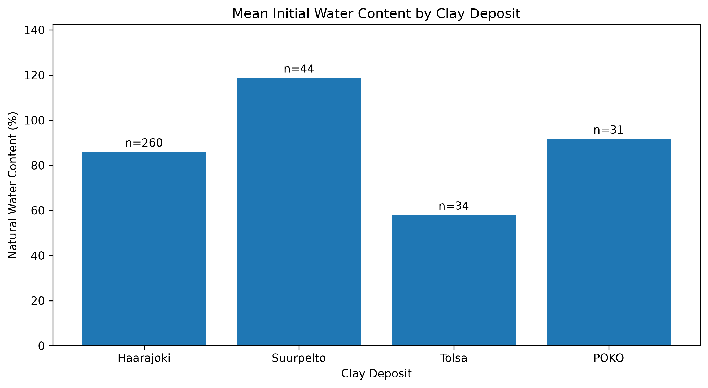
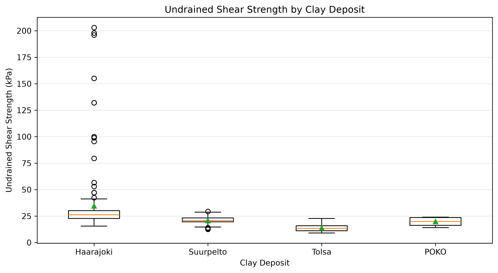

# Geotechnical Analysis of Four Finnish Clay Deposits

## 1. Introduction

This project investigates the geotechnical properties of four Finnish clay deposits: **Haarajoki, Suurpelto, Tolsa, and POKO**, using publicly available laboratory measurements.

The research question is:

**How do the geotechnical properties vary among the four Finnish clay deposits?**

The objective is to compare three geotechnical indicators through descriptive statistics and graphical representations using a reproducible Python workflow.

## 2. Dataset Description

The dataset is a reorganized version of the Finnish clay database associated with Löfman and Korkiala-Tanttu (2021), available through Borealis ([DOI: 10.80240/FK2/DZGAMU](https://doi.org/10.80240/FK2/DZGAMU)).

The laboratory dataset contains **375 observations and 50 variables**. Three parameters were selected for analysis:

| Variable | Description | Unit |
|---|---|---|
| `w0` | Natural water content | % |
| `su` | Undrained shear strength (fall cone test) | kPa |
| `gamma` | Unit weight | kN/m³ |

The selected parameters provide information about the physical and mechanical characteristics of the studied deposits.

## 3. Methodology

The analysis was performed using Python, Pandas, and Matplotlib within a Conda environment.

The reproducible workflow consists of three stages:

1. **Download:** `scripts/download_data.py` retrieves the original laboratory dataset from Borealis.
2. **Preprocessing:** `scripts/preprocess.py` standardizes column names, handles missing-value markers, and exports the cleaned dataset.
3. **Analysis:** `scripts/analyze.py` calculates the number of valid measurements, mean, and standard deviation of each parameter by deposit and generates comparative figures.

Missing measurements were excluded from individual statistical calculations without removing entire observations from the dataset.

The numerical results are saved in `results/geotechnical_statistics.csv`, and the figures are stored in `figures/`.

## 4. Results and Discussion

### 4.1 Statistical comparison

**Table 1. Mean geotechnical properties of the four Finnish clay deposits**

| Deposit | Water content (%) | Shear strength (kPa) | Unit weight (kN/m³) |
|---|---:|---:|---:|
| Haarajoki | 85.785 | 34.630 | 15.065 |
| Suurpelto | 118.636 | 20.780 | 13.720 |
| Tolsa | 57.838 | 13.729 | 16.650 |
| POKO | 91.577 | 19.841 | 14.635 |

The results indicate differences in the average geotechnical properties among the four deposits. Suurpelto exhibits the highest mean natural water content and the lowest mean unit weight, whereas Tolsa shows the opposite pattern.

Haarajoki has the highest mean undrained shear strength, while Tolsa has the lowest.

### 4.2 Natural water content

*Figure 1. Mean natural water content (%) by clay deposit.*

Suurpelto has the highest mean natural water content (**118.636%**), followed by POKO (**91.577%**), Haarajoki (**85.785%**), and Tolsa (**57.838%**).

The differences suggest variations in the physical characteristics of the studied clay deposits. Suurpelto also exhibits relatively high variability in water content, whereas Tolsa presents more consistent measurements.

### 4.3 Undrained shear strength

*Figure 2. Distribution of undrained shear strength (kPa) obtained from fall cone tests.*

Haarajoki exhibits the highest mean undrained shear strength (**34.630 kPa**) and the greatest variability among the studied deposits. Tolsa shows the lowest mean value (**13.729 kPa**).

The box plot illustrates differences in the distribution and variability of shear strength measurements between deposits.

### 4.4 Limitations

The number of available measurements varies between parameters and deposits. Of the 375 observations, 369 contain water content measurements, 189 contain undrained shear strength measurements, and 275 contain unit weight measurements.

Therefore, the comparisons are descriptive and may be influenced by differences in sampling depth, soil layers, and testing conditions. These factors were not explicitly controlled in the present analysis.

## 5. Conclusion

The statistical analysis revealed differences in the geotechnical properties of the four Finnish clay deposits.

Suurpelto is characterized by the highest mean natural water content and the lowest mean unit weight, whereas Tolsa presents the opposite characteristics. Haarajoki exhibits the highest mean undrained shear strength and substantial variability in the available measurements.

These findings highlight the variability of geotechnical properties across the studied deposits and demonstrate the usefulness of reproducible data analysis for comparing laboratory geotechnical measurements.

## 6. References

Löfman, M., & Korkiala-Tanttu, L. (2021). *Transformation models for the compressibility properties of Finnish clays using a multivariate database*. https://doi.org/10.1080/17499518.2020.1864410

*Geotechnical Properties of Four Finnish Clay Deposits — Reorganized Dataset*. Borealis Demo. https://doi.org/10.80240/FK2/DZGAMU
